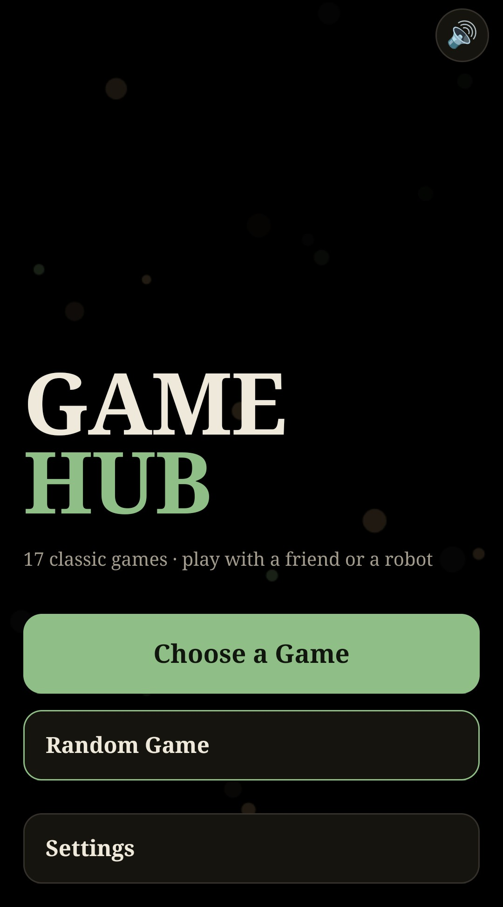
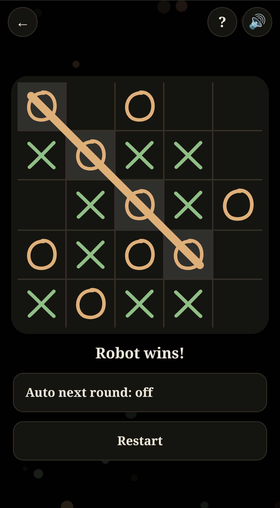
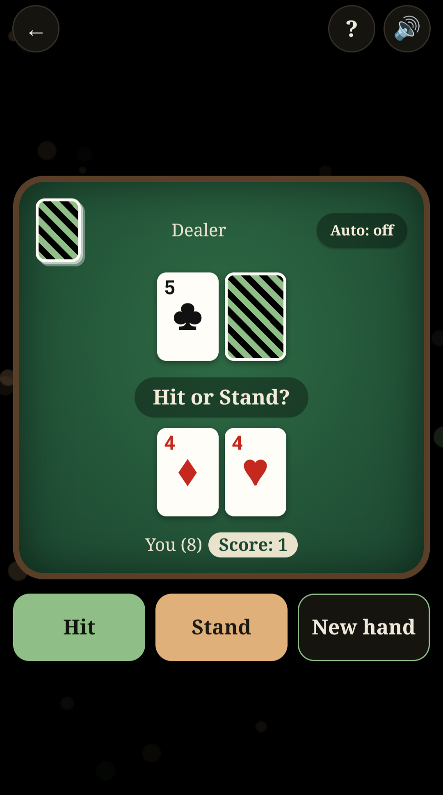
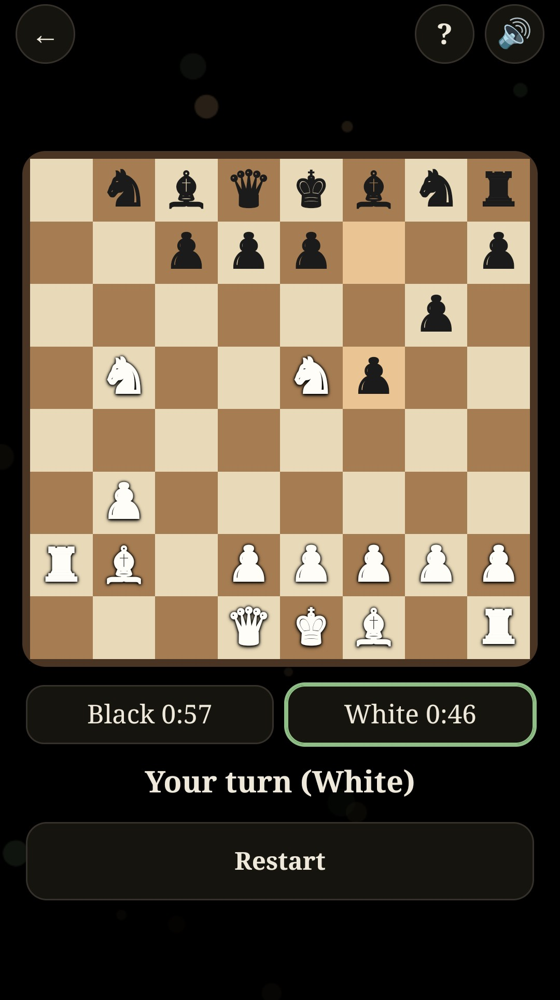
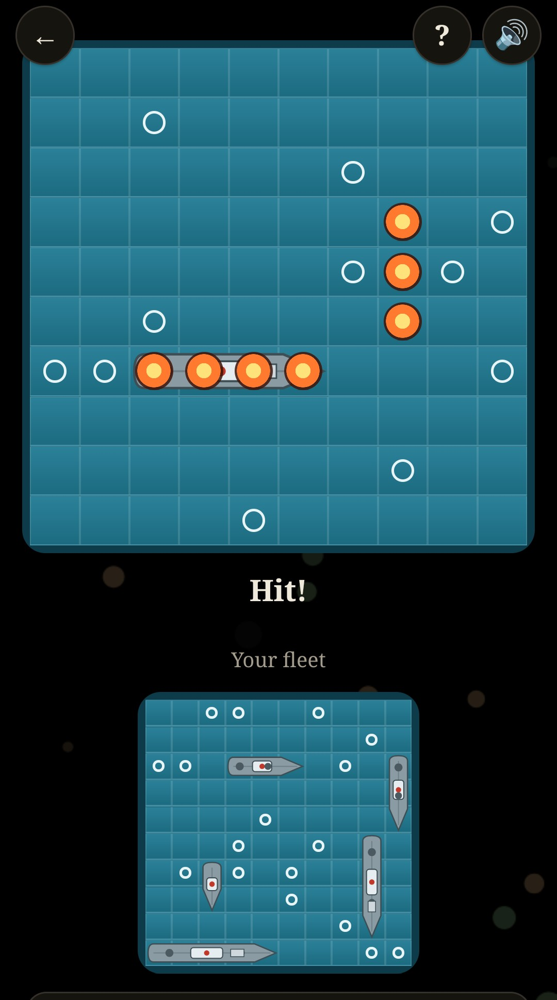
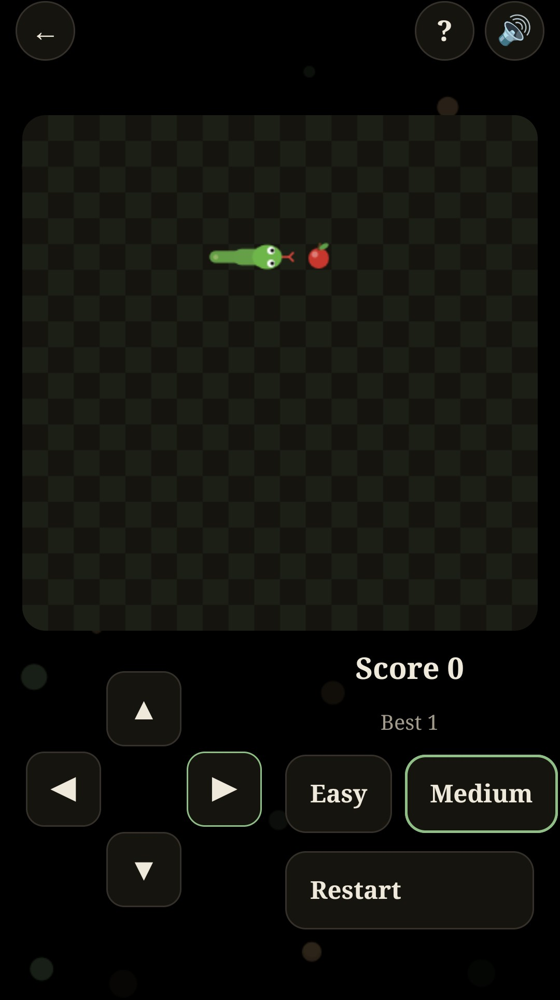

# Game Hub Arcade

A collection of classic board, card and puzzle games for Android. Play with a friend on one device or against a robot (Medium / Hard). No ads, no tracking, no network access.

**17 games:** Tic-Tac-Toe (3x3 to 7x7), Chess (with clocks), Dame, Backgammon, Connect Four, Mancala, Dots and Boxes, Memory, Battleship, Crazy Eights, Blackjack, Solitaire, Sudoku, Minesweeper, 2048, Falling Blocks, Snake.

Author: GitHub [bogdan-dev-ro](https://github.com/bogdan-dev-ro)

## Build
Open the folder in Android Studio and run, or use `./gradlew assembleDebug`. The games are plain HTML/JS in `app/src/main/assets/index.html`, shown in a WebView.

## License
GPL-3.0-only. See `LICENSE`.
